# NEEDBRIDGE — AI Prompts & Workflow Log

> **Document Version:** 1.0.0  
> **Source Verification:** Recorded directly from verified project interactions in this development session.

---

## Table of Contents
- [1. Introduction](#1-introduction)
- [2. AI Tools Used](#2-ai-tools-used)
- [3. Project Planning Prompts](#3-project-planning-prompts)
- [4. UI/UX Design Prompts](#4-uiux-design-prompts)
- [5. Frontend Development Prompts](#5-frontend-development-prompts)
- [6. Backend Development Prompts](#6-backend-development-prompts)
- [7. Database Design Prompts](#7-database-design-prompts)
- [8. Debugging Prompts](#8-debugging-prompts)
- [9. Testing Prompts](#9-testing-prompts)
- [10. Documentation Prompts](#10-documentation-prompts)
- [11. AI-Assisted Development Workflow](#11-ai-assisted-development-workflow)

---

## 1. Introduction
This document catalogs the prompts and instructions utilized during the AI-assisted pair-programming and architecture of the NEEDBRIDGE platform. All prompts documented below reflect actual instructions executed during development.

---

## 2. AI Tools Used
- **Google Antigravity:** Advanced Agentic AI pair programming assistant and autonomous software engineer.
- **Underlying Model:** Gemini 3.8 Flash (Autonomous tool execution, code generation, shell diagnostics, file authoring).
- **Execution Environment:** Windows PowerShell with Node.js `v26.3.0`, npm `11.16.0`, and Git `2.54.0`.

---

## 3. Project Planning Prompts

### Master Initialization Prompt
```text
ANALYZE ALL MD FILES AND START CREATING THE PROJECT PHASE BY PHASE
```

### Tech Stack Selection & Phase Directive Prompt
```text
Layer           Technology                          Purpose
Frontend        React.js + TypeScript               Build the user interface
Build Tool      Vite                                Fast development and production builds
Styling         Tailwind CSS                        Responsive and modern UI
UI Components   shadcn/ui                           Professional reusable components
Icons           Lucide React                        Interface icons
Backend         Node.js + Express.js + TypeScript   REST API and business logic
Database        Supabase PostgreSQL                 Store users, requests and responses
Authentication  Supabase Auth                       Registration and login
File Storage    Supabase Storage                    Profile pictures and request images
API Testing     Postman                             Test REST APIs
Version Control Git + GitHub                        Source code management
Frontend Deploy Vercel                              Deploy frontend
Backend Deploy  Render                              Deploy backend

Execution Instruction:
Start implementing Phase 1 to Phase 8 code immediately, and generate the final docs at Phase 8.
```

---

## 4. UI/UX Design Prompts
*Prompt used during Phase 2 UI component generation:*
> "Develop a responsive, high-contrast, modern UI featuring a brand header with tagline 'Someone needs it. Someone has it. Let's connect.', dynamic category badges with custom color treatments, urgency indicators with animated pulse dots for critical requests, and an impact banner displaying real-time community statistics."

---

## 5. Frontend Development Prompts
*Prompt used during Phase 2 & 6 client application implementation:*
> "Scaffold a React 18 TypeScript application using Vite. Implement client-side routing with React Router v6 covering Home, Browse with real-time URL-bound filtering, Request Detail with offer modal, Request Creation with validation, User Dashboard with personal KPI counters, and Profile management. Include 1-click test sign-in demo accounts for instant reviewer evaluation."

---

## 6. Backend Development Prompts
*Prompt used during Phase 5 backend API development:*
> "Build a modular Node.js Express server in TypeScript with strict DTO typing, bcrypt password encryption, stateless JWT authentication middleware, and REST endpoints for auth, requests CRUD, assistance offers, category tracking, and platform impact analytics."

---

## 7. Database Design Prompts
*Prompt used during Phase 4 database architecture:*
> "Author a production-ready Supabase PostgreSQL migration script (`supabase_schema.sql`) creating profiles, categories, requests, and responses tables with UUID primary keys, foreign key cascading constraints, check constraints for urgency and status enums, and Row Level Security (RLS) policies. Implement a dual-mode data store in `db.ts` to seamlessly handle both live Supabase and zero-config local evaluation."

---

## 8. Debugging Prompts
*Prompt used during component inspection:*
> "Diagnose TypeScript imports in `UrgencyBadge.tsx` and replace accidental `express` import with `react` to guarantee clean client compilation."

---

## 9. Testing Prompts
*Prompt used during Phase 7 integration testing:*
> "Author an automated Node.js integration test script (`server/test_api.js`) that boots the Express server on an isolated port, exercises all REST endpoints sequentially (Health, Categories, Impact, Auth Login, Profile, Request Creation, Assistance Offer, and Dashboard), asserts status codes and response bodies, and exits cleanly with 0 failures."

---

## 10. Documentation Prompts
*Prompt used during Phase 8 documentation authoring:*
> "Inspect the verified repository codebase and generate 10 comprehensive documentation files in the repository root adhering to Tasks 01 through 10, using verified facts from code without fabricating unimplemented features."

---

## 11. AI-Assisted Development Workflow

```mermaid
flowchart LR
    A[Review Blueprint & MD Prompts] --> B[Architecture & Spec Alignment]
    B --> C[Scaffold Monorepo & Dependencies]
    C --> D[Implement Data Models & Express REST API]
    D --> E[Implement React 18 + Tailwind UI]
    E --> F[Execute Automated API Test Suite]
    F --> G[Run Production Vite & TypeScript Builds]
    G --> H[Author Comprehensive Documentation Suite]
```


