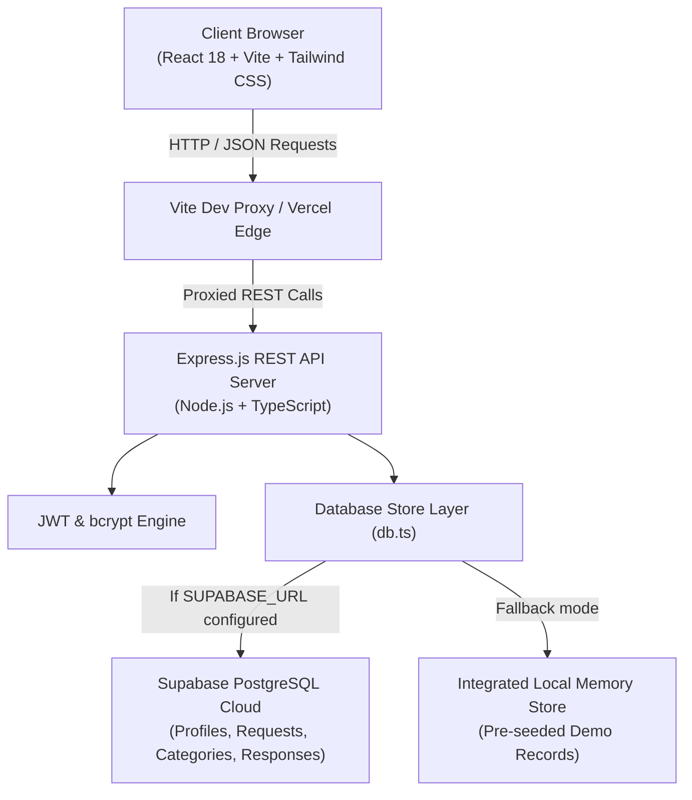
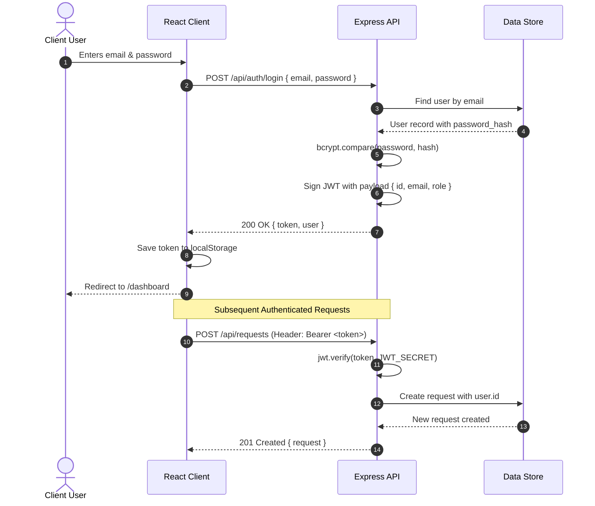
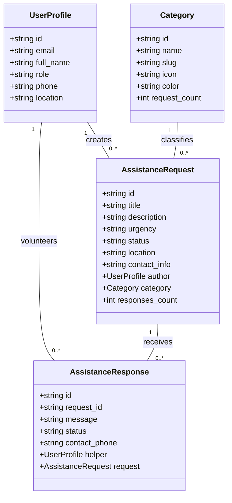

# NEEDBRIDGE — System Architecture & Design

> **Document Version:** 1.0.0  
> **Architecture Pattern:** Decoupled Client-Server Tiered Architecture (RESTful API + Single Page Application)

---

## Table of Contents
- [1. Architecture Overview](#1-architecture-overview)
- [2. Architectural Style](#2-architectural-style)
- [3. High-Level System Architecture](#3-high-level-system-architecture)
- [4. Frontend Architecture](#4-frontend-architecture)
- [5. Backend Architecture](#5-backend-architecture)
- [6. Database Architecture](#6-database-architecture)
- [7. Authentication Architecture](#7-authentication-architecture)
- [8. Request and Response Flow](#8-request-and-response-flow)
- [9. Module Responsibilities](#9-module-responsibilities)
- [10. Component Relationships](#10-component-relationships)
- [11. Security Architecture](#11-security-architecture)
- [12. Scalability Considerations](#12-scalability-considerations)
- [13. Architecture Diagrams](#13-architecture-diagrams)

---

## 1. Architecture Overview
NEEDBRIDGE is architected as a modular, decoupled full-stack web application designed for developer productivity, fast build times, and resilient execution. It separates concerns across:
1. **Presentation Layer:** React 18 SPA powered by Vite, Tailwind CSS, Lucide icons, and React Router.
2. **API & Business Logic Layer:** Node.js Express REST API written in TypeScript with modular controllers, routes, and middleware.
3. **Persistence Layer:** Supabase PostgreSQL with schema definitions, relational constraints, RLS policies, alongside an integrated dual-mode datastore ensuring seamless local zero-config testing.

---

## 2. Architectural Style
- **Decoupled Client-Server:** The frontend communicates strictly over standardized RESTful JSON endpoints.
- **Stateless REST:** The server maintains no in-memory session state for client interactions; authentication is validated via cryptographic JWT bearer tokens.
- **Component-Driven UI:** UI state is encapsulated within reusable components and React Context providers.
- **Fail-Safe Persistence Pattern:** Dual-mode data access layer automatically routes requests to live Supabase PostgreSQL when credentials exist, falling back to an integrated seed datastore for local preview.

---

## 3. High-Level System Architecture



---

## 4. Frontend Architecture
The client codebase is structured around React functional components, hooks, and clean layer separation:
- `src/components/`: Reusable, atomic UI elements (`Navbar`, `Footer`, `RequestCard`, `UrgencyBadge`, `StatusBadge`, `ImpactBanner`, `CategoryIcon`).
- `src/pages/`: Page-level route views (`HomePage`, `BrowseRequestsPage`, `RequestDetailPage`, `CreateRequestPage`, `DashboardPage`, `LoginPage`, `RegisterPage`, `ProfilePage`).
- `src/context/`: Global client state management (`AuthContext` managing user authentication, login/logout actions, and token persistence in `localStorage`).
- `src/services/`: Isolated API client (`api.ts`) managing all network requests with error interception and header propagation.
- `src/types/`: Strict TypeScript interfaces mirroring data transfer objects (DTOs).

---

## 5. Backend Architecture
The backend application follows standard layered architecture:
```
server/src/
├── config/       # Environment parsing & Supabase client initialization
├── controllers/  # Request handlers, input validation, and business logic
├── middleware/   # JWT verification, authentication guards, and error handlers
├── models/       # Data persistence, queries, seed records, and entity hydration
├── routes/       # Express router definitions mapping HTTP verbs to controllers
├── types/        # TypeScript interfaces for API entities
└── index.ts      # Server bootstrap, CORS setup, and route mounting
```

---

## 6. Database Architecture
Data entities follow relational normalized structures:
- **`profiles` (Users):** Stores user identity, bcrypt hashed credentials, contact info, bio, and role (`user`, `volunteer`, `admin`).
- **`categories`:** Support areas (Academic, Food, Transport, Health, Household, Tech, Other) with icons and color schemes.
- **`requests`:** Assistance requests tied to author profile with foreign key `user_id`, categorized with `category_id`, urgency level, status, location, and contact information.
- **`responses`:** Assistance offers tied to `request_id` and `helper_id` with message text and offer status.

---

## 7. Authentication Architecture



---

## 8. Request and Response Flow
1. **Client Action:** User triggers a state mutation (e.g., submitting an offer on a request).
2. **API Service Call:** `client/src/services/api.ts` attaches `Authorization: Bearer <token>` and dispatches `fetch` request.
3. **Middleware Interception:** Express passes request through `cors()`, `express.json()`, and `authenticateToken` middleware.
4. **Controller Execution:** `responseController.ts` extracts `requestId`, validates non-empty message and non-self-help business rule.
5. **Persistence Mutation:** `db.createResponse()` updates database records and increments `responses_count` on the parent request.
6. **Hydration & Response:** Returns normalized JSON response payload with HTTP 201 status.
7. **Client Re-render:** React updates UI dynamically and displays feedback toast.

---

## 9. Module Responsibilities

| Module | Core Responsibility |
|---|---|
| `authController` | Handles user registration, bcrypt password hashing, login token generation, and profile retrieval/updating. |
| `requestController` | Handles listing with search/filters, single request inspection, creation, status transitions, and deletion. |
| `responseController` | Handles assistance offer submissions and status state machine updates (`pending` &rarr; `accepted` &rarr; `completed` / `declined`). |
| `categoryController` | Delivers category list with live request counts per category. |
| `dashboardController` | Calculates global community impact metrics and aggregates authenticated user's personal requests and offers. |
| `authMiddleware` | Enforces JWT token validation and decodes user context onto `req.user`. |

---

## 10. Component Relationships



---

## 11. Security Architecture
- **Credential Storage:** All user passwords hashed via `bcryptjs` using a salt work factor of 10.
- **Transport Security:** Production deployment uses HTTPS over TLS via Vercel and Render edge layers.
- **Authorization Verification:** Sensitive mutations (creating requests, submitting offers, changing status) require valid JWT signature.
- **Author Guarding:** Request authors are checked before allowing status change or deletion.
- **Input Sanitization:** URL query params and search strings are trimmed and lowercased before execution.

---

## 12. Scalability Considerations
- **Stateless Server Nodes:** The Express REST API is entirely stateless, allowing horizontal scaling across multiple instances behind a load balancer.
- **Connection Pooling:** In production with Supabase PostgreSQL, Supabase connection pooler handles thousands of concurrent database connections.
- **Static Asset Caching:** Client assets built via Vite are fingerprinted with content hashes and served via CDN with immutable cache headers.
- **Read-Heavy Optimization:** Category listings and impact stats can be cached via Redis or in-memory TTL cache as traffic scales.

---

## 13. Architecture Diagrams

### Detailed System Topology
```
[ Browser / Mobile Client ]
             │
             ▼
   [ HTTPS / DNS Router ]
             │
      ┌──────┴──────────────────────────┐
      ▼                                 ▼
[ Vercel Edge CDN ]              [ Render Web Service ]
(Static React 18 SPA)            (Node.js Express API)
                                        │
                         ┌──────────────┴──────────────┐
                         ▼                             ▼
                 [ Supabase Auth ]            [ Supabase Postgres ]
                 (Identity Provider)          (Relational Database)
```
