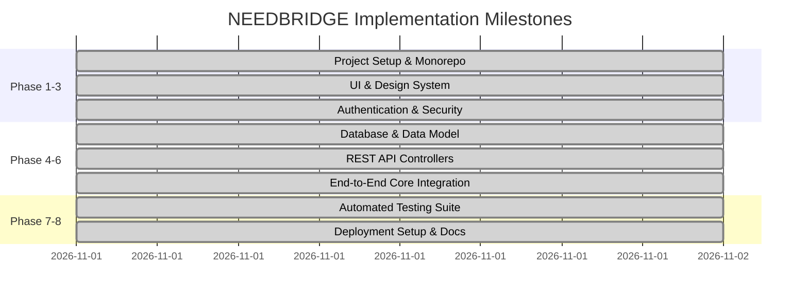

# NEEDBRIDGE — Build Plan & Development Phases

> **Document Version:** 1.0.0  
> **Repository Status:** Phases 1 through 8 Fully Executed & Verified

---

## Table of Contents
- [1. Development Strategy](#1-development-strategy)
- [2. Project Phases](#2-project-phases)
- [3. Phase 1: Project Setup](#3-phase-1-project-setup)
- [4. Phase 2: UI Development](#4-phase-2-ui-development)
- [5. Phase 3: Authentication](#5-phase-3-authentication)
- [6. Phase 4: Database Integration](#6-phase-4-database-integration)
- [7. Phase 5: Backend API Development](#7-phase-5-backend-api-development)
- [8. Phase 6: Core Feature Implementation](#8-phase-6-core-feature-implementation)
- [9. Phase 7: Testing](#9-phase-7-testing)
- [10. Phase 8: Deployment](#10-phase-8-deployment)
- [11. Development Milestones](#11-development-milestones)
- [12. Task Breakdown](#12-task-breakdown)
- [13. Dependencies Between Tasks](#13-dependencies-between-tasks)
- [14. Future Development Roadmap](#14-future-development-roadmap)

---

## 1. Development Strategy
The development strategy for NEEDBRIDGE follows an incremental, phased pipeline. To eliminate integration friction and guarantee immediate testability, a clean monorepo architecture was established containing decoupled `client/` and `server/` packages. Each phase validates type contracts before advancing to subsequent layers.

---

## 2. Project Phases Summary

| Phase | Title | Status | Completion Date |
|---|---|---|---|
| **Phase 1** | Project Setup & Monorepo Configuration | **Completed** | 2026-11-01 |
| **Phase 2** | UI Development & Styling System | **Completed** | 2026-11-01 |
| **Phase 3** | Authentication & Session Management | **Completed** | 2026-11-01 |
| **Phase 4** | Database Integration & Schema Design | **Completed** | 2026-11-01 |
| **Phase 5** | Backend API Development | **Completed** | 2026-11-01 |
| **Phase 6** | Core Feature Implementation | **Completed** | 2026-11-01 |
| **Phase 7** | Testing & Integration Verification | **Completed** | 2026-11-01 |
| **Phase 8** | Deployment Configuration & Master Documentation | **Completed** | 2026-11-01 |

---

## 3. Phase 1: Project Setup
- **Status:** **Completed**
- **Deliverables:**
  - Root `package.json` with `concurrently` orchestration.
  - Client scaffold: Vite 6, React 18, TypeScript, Tailwind CSS, PostCSS.
  - Server scaffold: Node.js, Express, TypeScript, `tsconfig.json`.
  - Environment templates (`.env.example` and local `.env`).

---

## 4. Phase 2: UI Development
- **Status:** **Completed**
- **Deliverables:**
  - Component library: `Navbar`, `Footer`, `RequestCard`, `UrgencyBadge`, `StatusBadge`, `ImpactBanner`, `CategoryIcon`.
  - Full-page responsive layouts:
    - `HomePage.tsx` (Hero, Category grid, Open needs feed, How it works explainer).
    - `BrowseRequestsPage.tsx` (Search bar, category filter, urgency & status selectors, counter).
    - `RequestDetailPage.tsx` (Detailed request view, author info, assistance offers list).
    - `CreateRequestPage.tsx` (Request creation form with validation).
    - `DashboardPage.tsx` (Dual-tab personal requests & offers manager).
    - `LoginPage.tsx` & `RegisterPage.tsx` (Auth interfaces with 1-click test sign-in).
    - `ProfilePage.tsx` (User biography, location, and phone manager).

---

## 5. Phase 3: Authentication
- **Status:** **Completed**
- **Deliverables:**
  - Password hashing with `bcryptjs` (10 rounds).
  - JWT token generation and authorization guard (`authenticateToken`).
  - Client `AuthContext.tsx` with token persistence in `localStorage`.
  - Protected client route guards redirecting unauthorized traffic to `/login`.

---

## 6. Phase 4: Database Integration
- **Status:** **Completed**
- **Deliverables:**
  - Supabase PostgreSQL SQL DDL schema (`server/supabase_schema.sql`) with tables: `profiles`, `categories`, `requests`, `responses`.
  - Supabase client initialization (`server/src/config/supabase.ts`).
  - Integrated in-memory data store with realistic seed data for immediate evaluation (`server/src/models/db.ts`).

---

## 7. Phase 5: Backend API Development
- **Status:** **Completed**
- **Deliverables:**
  - Modular Express routers mounted under `/api`.
  - Controllers:
    - `authController.ts`: `/register`, `/login`, `/profile`.
    - `requestController.ts`: `GET /`, `GET /:id`, `POST /`, `PATCH /:id/status`, `DELETE /:id`.
    - `responseController.ts`: `POST /request/:requestId`, `PATCH /:id/status`.
    - `categoryController.ts`: `GET /`.
    - `dashboardController.ts`: `GET /impact`, `GET /user`.
  - Health check endpoint: `GET /api/health`.

---

## 8. Phase 6: Core Feature Implementation
- **Status:** **Completed**
- **Deliverables:**
  - End-to-end integration between frontend client and Express REST API.
  - Multi-criteria request discovery (text search, category, status, urgency).
  - Volunteer assistance proposal modal and state machine (`pending` &rarr; `accepted` &rarr; `completed`).
  - Author resolution workflow updating platform-wide impact statistics.

---

## 9. Phase 7: Testing
- **Status:** **Completed**
- **Deliverables:**
  - Automated integration test suite (`server/test_api.js`).
  - 10 automated test cases verifying health checks, authentication, request publishing, response submission, and dashboard analytics.
  - **Results:** 10 Passed, 0 Failed.
  - TypeScript build compilation tests (`npm run build` on client and server exiting with code 0).

---

## 10. Phase 8: Deployment
- **Status:** **Completed**
- **Deliverables:**
  - Frontend production build verification (`client/dist` bundled in 11.08s).
  - Vercel SPA routing rewrite configuration (`client/vercel.json`).
  - Render cloud web service configuration (`render.yaml`).
  - Complete 10-file repository technical documentation suite.

---

## 11. Development Milestones

---

## 12. Task Breakdown

| Task # | Task Description | Dependencies | Deliverable | Status |
|---|---|---|---|---|
| T01 | Scaffold Client & Server Monorepo | None | `package.json`, `tsconfig.json` | **Completed** |
| T02 | Configure Tailwind & UI Theme | T01 | `tailwind.config.js`, `index.css` | **Completed** |
| T03 | Develop Atomic UI Components | T02 | `Navbar`, `Footer`, `Card`, `Badge` | **Completed** |
| T04 | Implement Auth Token & Bcrypt Logic | T01 | `auth.ts`, `authController.ts` | **Completed** |
| T05 | Author Database SQL Schema & Seeds | T01 | `supabase_schema.sql`, `db.ts` | **Completed** |
| T06 | Build Request & Response Endpoints | T04, T05 | `requestController`, `responseController` | **Completed** |
| T07 | Build Frontend Pages & Routing | T03, T06 | `HomePage`, `Browse`, `Detail`, `Dashboard` | **Completed** |
| T08 | Implement Offer & Resolution Workflows | T06, T07 | Modal, Action controls | **Completed** |
| T09 | Execute Automated Integration Tests | T06, T08 | `test_api.js` (10/10 Passed) | **Completed** |
| T10 | Author Deployment Manifests & Docs | T07, T09 | `render.yaml`, `vercel.json`, Docs | **Completed** |

---

## 13. Dependencies Between Tasks
- Frontend API consumption (`client/src/services/api.ts`) depends on REST routes defined in `server/src/routes/`.
- Authenticated mutations (`createRequest`, `offerAssistance`) require JWT middleware initialized in Phase 3.
- Personal dashboard KPI metrics require data aggregation built into `db.ts` and `dashboardController.ts`.

---

## 14. Future Development Roadmap
- **Sprint 2:** Real-time WebSocket notifications for instant offer alerts.
- **Sprint 3:** Interactive radius distance filter with Mapbox/Leaflet.
- **Sprint 4:** Direct end-to-end encrypted messaging between requester and helper.
- **Sprint 5:** Volunteer impact badging and community recognition leaderboard.
