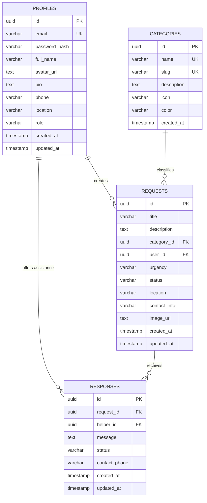

# NEEDBRIDGE — Database Schema & Data Models

> **Document Version:** 1.0.0  
> **Source Verification:** Extracted directly from [`server/supabase_schema.sql`](file:///c:/Users/hp/OneDrive/Pictures/Desktop/NEEDBRIDGE/server/supabase_schema.sql) and [`server/src/models/db.ts`](file:///c:/Users/hp/OneDrive/Pictures/Desktop/NEEDBRIDGE/server/src/models/db.ts).

---

## Table of Contents
- [1. Database Overview](#1-database-overview)
- [2. Database Technology](#2-database-technology)
- [3. Entity Relationship Diagram](#3-entity-relationship-diagram)
- [4. Users Table (`profiles`)](#4-users-table-profiles)
- [5. Requests Table (`requests`)](#5-requests-table-requests)
- [6. Categories Table (`categories`)](#6-categories-table-categories)
- [7. Responses Table (`responses`)](#7-responses-table-responses)
- [8. Notifications Table](#8-notifications-table)
- [9. Table Relationships](#9-table-relationships)
- [10. Primary and Foreign Keys](#10-primary-and-foreign-keys)
- [11. Indexes and Constraints](#11-indexes-and-constraints)
- [12. Data Validation](#12-data-validation)
- [13. Database Security](#13-database-security)
- [14. Example SQL Queries](#14-example-sql-queries)

---

## 1. Database Overview
The NEEDBRIDGE database is designed around a relational schema structured for community mutual aid. It tracks user profiles, standardized assistance categories, published assistance requests, and volunteer offers of assistance with status lifecycles.

---

## 2. Database Technology
- **Database Engine:** Supabase PostgreSQL (Version 15+ compatible).
- **Extensions:** `uuid-ossp` for cryptographically strong primary keys (`UUID v4`).
- **Data Access Layer:** Supabase JavaScript SDK (`@supabase/supabase-js`) with dual-mode fallback in `server/src/models/db.ts`.

---

## 3. Entity Relationship Diagram



---

## 4. Users Table (`profiles`)
Stores user identities, credentials, public profile information, and roles.

| Column | Type | Constraints | Description |
|---|---|---|---|
| `id` | `UUID` | `PRIMARY KEY, DEFAULT uuid_generate_v4()` | Unique user identifier. |
| `email` | `VARCHAR(255)` | `NOT NULL, UNIQUE` | User login email. |
| `password_hash` | `VARCHAR(255)` | `NULLABLE` | Bcrypt salt & hash (10 work factor). |
| `full_name` | `VARCHAR(255)` | `NOT NULL` | Display name of the user/volunteer. |
| `avatar_url` | `TEXT` | `NULLABLE` | URL to profile picture. |
| `bio` | `TEXT` | `NULLABLE` | Short biographical description. |
| `phone` | `VARCHAR(50)` | `NULLABLE` | Optional contact telephone coordinate. |
| `location` | `VARCHAR(255)` | `NULLABLE` | General neighborhood or campus block. |
| `role` | `VARCHAR(50)` | `DEFAULT 'user', CHECK (role IN ('user', 'volunteer', 'admin'))` | User permission role. |
| `created_at` | `TIMESTAMPTZ` | `DEFAULT NOW()` | Account creation timestamp. |
| `updated_at` | `TIMESTAMPTZ` | `DEFAULT NOW()` | Profile last modified timestamp. |

---

## 5. Requests Table (`requests`)
Stores community assistance requests posted by users.

| Column | Type | Constraints | Description |
|---|---|---|---|
| `id` | `UUID` | `PRIMARY KEY, DEFAULT uuid_generate_v4()` | Unique request identifier. |
| `title` | `VARCHAR(255)` | `NOT NULL` | Brief headline describing the need. |
| `description` | `TEXT` | `NOT NULL` | Comprehensive details of the request. |
| `category_id` | `UUID` | `REFERENCES categories(id) ON DELETE SET NULL` | Category classification. |
| `user_id` | `UUID` | `REFERENCES profiles(id) ON DELETE CASCADE, NOT NULL` | Profile ID of the requester. |
| `urgency` | `VARCHAR(50)` | `DEFAULT 'medium', CHECK (urgency IN ('low', 'medium', 'high', 'critical'))` | Urgency tier. |
| `status` | `VARCHAR(50)` | `DEFAULT 'open', CHECK (status IN ('open', 'in_progress', 'resolved', 'closed'))` | Current lifecycle status. |
| `location` | `VARCHAR(255)` | `NOT NULL` | Safe handover location/neighborhood. |
| `contact_info` | `VARCHAR(255)` | `NULLABLE` | Requester's contact instruction. |
| `image_url` | `TEXT` | `NULLABLE` | Optional reference photo URL. |
| `created_at` | `TIMESTAMPTZ` | `DEFAULT NOW()` | Publication timestamp. |
| `updated_at` | `TIMESTAMPTZ` | `DEFAULT NOW()` | Last update timestamp. |

---

## 6. Categories Table (`categories`)
Standardized mutual aid classifications.

| Column | Type | Constraints | Description |
|---|---|---|---|
| `id` | `UUID` | `PRIMARY KEY, DEFAULT uuid_generate_v4()` | Unique category identifier. |
| `name` | `VARCHAR(100)` | `NOT NULL, UNIQUE` | Category label (e.g., 'Academic & Tutoring'). |
| `slug` | `VARCHAR(100)` | `NOT NULL, UNIQUE` | URL-friendly slug (`academic`, `food`, etc.). |
| `description` | `TEXT` | `NULLABLE` | Scope and examples of items. |
| `icon` | `VARCHAR(50)` | `NULLABLE` | Lucide React icon name identifier. |
| `color` | `VARCHAR(50)` | `NULLABLE` | Tailwind badge CSS color class string. |
| `created_at` | `TIMESTAMPTZ` | `DEFAULT NOW()` | Creation timestamp. |

---

## 7. Responses Table (`responses`)
Stores volunteer offers of assistance proposed for active requests.

| Column | Type | Constraints | Description |
|---|---|---|---|
| `id` | `UUID` | `PRIMARY KEY, DEFAULT uuid_generate_v4()` | Unique response identifier. |
| `request_id` | `UUID` | `REFERENCES requests(id) ON DELETE CASCADE, NOT NULL` | Target request identifier. |
| `helper_id` | `UUID` | `REFERENCES profiles(id) ON DELETE CASCADE, NOT NULL` | Profile ID of volunteer offering aid. |
| `message` | `TEXT` | `NOT NULL` | Description of how volunteer can help. |
| `status` | `VARCHAR(50)` | `DEFAULT 'pending', CHECK (status IN ('pending', 'accepted', 'completed', 'declined'))` | Offer status. |
| `contact_phone` | `VARCHAR(50)` | `NULLABLE` | Helper's phone number for coordination. |
| `created_at` | `TIMESTAMPTZ` | `DEFAULT NOW()` | Offer creation timestamp. |
| `updated_at` | `TIMESTAMPTZ` | `DEFAULT NOW()` | Offer status update timestamp. |

---

## 8. Notifications Table
> **Status:** **Not implemented**  
*(Notifications are currently handled synchronously via UI status feedback alerts and dashboard aggregates. Real-time push notification table is reserved for future scope).*

---

## 9. Table Relationships
1. **`profiles` to `requests`:** One-to-Many (`1:N`). A user can create multiple requests; each request belongs to one author profile (`ON DELETE CASCADE`).
2. **`categories` to `requests`:** One-to-Many (`1:N`). A category classifies multiple requests; deleting a category sets `category_id` to NULL.
3. **`profiles` to `responses`:** One-to-Many (`1:N`). A volunteer can offer assistance to multiple requests (`ON DELETE CASCADE`).
4. **`requests` to `responses`:** One-to-Many (`1:N`). A single request can receive multiple volunteer assistance offers (`ON DELETE CASCADE`).

---

## 10. Primary and Foreign Keys
- **Primary Keys:**
  - `profiles.id`: UUID v4 Primary Key
  - `categories.id`: UUID v4 Primary Key
  - `requests.id`: UUID v4 Primary Key
  - `responses.id`: UUID v4 Primary Key
- **Foreign Keys:**
  - `requests.category_id` &rarr; `categories(id)`
  - `requests.user_id` &rarr; `profiles(id)`
  - `responses.request_id` &rarr; `requests(id)`
  - `responses.helper_id` &rarr; `profiles(id)`

---

## 11. Indexes and Constraints
- `profiles(email)`: `UNIQUE` constraint for unique authentication credentials.
- `categories(slug)`: `UNIQUE` constraint for URL routing.
- Check constraints enforce enum validity on:
  - `profiles.role IN ('user', 'volunteer', 'admin')`
  - `requests.urgency IN ('low', 'medium', 'high', 'critical')`
  - `requests.status IN ('open', 'in_progress', 'resolved', 'closed')`
  - `responses.status IN ('pending', 'accepted', 'completed', 'declined')`

---

## 12. Data Validation
- Server controller enforces non-empty string validation on `title`, `description`, `location`, `message`.
- Requests require a valid `category_id`.
- Users cannot submit offers to their own requests (`request.user_id !== req.user.id`).
- Passwords must be at least 6 characters in length.

---

## 13. Database Security
- **Row Level Security (RLS):** Enabled on all tables (`ALTER TABLE ... ENABLE ROW LEVEL SECURITY`).
- **Read Access:** Public `SELECT` allowed on `categories` and `requests`.
- **Write Access:** Authenticated users only can `INSERT` requests and responses.
- **Update Access:** Scoped to owning authors (`auth.uid() = user_id`).

---

## 14. Example SQL Queries

### Retrieve Open Critical Requests with Category and Author
```sql
SELECT 
    r.id,
    r.title,
    r.urgency,
    r.location,
    r.created_at,
    c.name AS category_name,
    p.full_name AS requester_name
FROM public.requests r
JOIN public.categories c ON r.category_id = c.id
JOIN public.profiles p ON r.user_id = p.id
WHERE r.status = 'open' AND r.urgency = 'critical'
ORDER BY r.created_at DESC;
```

### Calculate Community Resolution Metrics
```sql
SELECT 
    COUNT(*) AS total_requests,
    COUNT(*) FILTER (WHERE status = 'resolved') AS resolved_requests,
    ROUND((COUNT(*) FILTER (WHERE status = 'resolved')::decimal / NULLIF(COUNT(*), 0)) * 100, 1) AS resolution_percentage
FROM public.requests;
```
