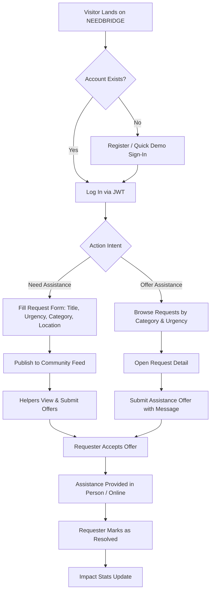

# NEEDBRIDGE — Product Requirements Document (PRD)

> **Document Version:** 1.0.0  
> **Status:** Approved / Active Development  
> **Platform:** Web Application (Responsive Desktop, Tablet, Mobile)  

---

## Table of Contents
- [1. Product Overview](#1-product-overview)
- [2. Problem Definition](#2-problem-definition)
- [3. Product Vision and Mission](#3-product-vision-and-mission)
- [4. Target Audience](#4-target-audience)
- [5. User Personas](#5-user-personas)
- [6. Functional Requirements](#6-functional-requirements)
- [7. Non-Functional Requirements](#7-non-functional-requirements)
- [8. User Stories](#8-user-stories)
- [9. User Workflows](#9-user-workflows)
- [10. Feature Specifications](#10-feature-specifications)
- [11. Business Rules](#11-business-rules)
- [12. Security Requirements](#12-security-requirements)
- [13. Success Metrics](#13-success-metrics)
- [14. Future Scope](#14-future-scope)

---

## 1. Product Overview
**NEEDBRIDGE** is a peer-to-peer community mutual assistance and resource-sharing web application. It connects people facing temporary shortages or requiring help with local neighbors, students, and volunteers willing to provide aid without financial transaction or commercial friction.

## 2. Problem Definition
Community members and students often face short-term resource deficits (e.g., educational textbooks, medical transport, emergency grocery essentials, or hardware tools). Commercial platforms enforce monetary transactions and high platform fees. Existing social groups (Facebook groups, WhatsApp, Discord) suffer from unindexed ephemeral feeds where critical emergencies get buried under chat noise. There is a lack of structured tracking, urgency flags, status resolution, and transparent community metrics.

## 3. Product Vision and Mission
- **Vision:** A world where no community member suffers through an solvable emergency or resource gap while a neighbor has that exact resource lying idle.
- **Mission:** Democratize mutual aid by providing a frictionless, zero-barrier, categorized digital bridge for neighborly support.

## 4. Target Audience
1. **University & College Students:** Seeking textbook loans, course tutoring, tech troubleshooting, and student carpools.
2. **Local Community Neighbors:** In need of grocery essentials, household tool borrowing, or elderly transport.
3. **Volunteers & Altruists:** Willing to lend time, skills, items, or transportation to those in need.
4. **NGOs & Grassroots Organizations:** Coordinating small-scale local relief and tracking community needs.

## 5. User Personas

### Persona A: Sarah Chen (Student in Need)
- **Age:** 20, Undergraduate Computer Science Student.
- **Context:** Struggling to afford an expensive \$180 textbook before midterms; needs a quiet study group or short-term loan.
- **Goals:** Quickly post a request, find an upperclassman with a spare copy, and confirm safe on-campus handover.
- **Frustrations:** Facebook groups are spam-ridden; campus bookstores charge exorbitant prices.

### Persona B: Marcus Johnson (Community Volunteer)
- **Age:** 34, Freelance Developer with access to a vehicle.
- **Context:** Has spare time on weekends and excess equipment (monitors, cables, tools).
- **Goals:** Browse local needs filtered by proximity and urgency; provide direct, verified aid.
- **Frustrations:** Bureaucratic charity applications that take weeks before he can help anyone.

## 6. Functional Requirements

| ID | Requirement Category | Description | Status |
|---|---|---|---|
| **FR-01** | **Authentication** | Users can register with email, password, full name, role, phone, and location. Passwords hashed using bcrypt. | **Implemented** |
| **FR-02** | **Session Management** | Authenticated users receive JWT tokens stored securely on the client with authorization headers. | **Implemented** |
| **FR-03** | **Profile Management** | Users can inspect and update their public profiles (full name, bio, phone, location, avatar). | **Implemented** |
| **FR-04** | **Create Request** | Requesters can publish assistance posts with title, category, description, urgency, location, and optional images. | **Implemented** |
| **FR-05** | **Browse & Filter** | Users can browse all open requests, filter by category, urgency (`low`, `medium`, `high`, `critical`), and status (`open`, `in_progress`, `resolved`). | **Implemented** |
| **FR-06** | **Search** | Full-text keyword search across request titles, descriptions, and locations. | **Implemented** |
| **FR-07** | **Offer Assistance** | Registered volunteers can submit assistance offers with supportive notes and contact numbers. | **Implemented** |
| **FR-08** | **Offer Response Flow** | Requesters can accept offers, decline offers, or mark accepted offers as completed. | **Implemented** |
| **FR-09** | **Request Resolution** | Requesters can transition request status from `open` &rarr; `in_progress` &rarr; `resolved` or reopen. | **Implemented** |
| **FR-10** | **Personal Dashboard** | Dual-tab dashboard aggregating user's posted requests and volunteer offers with live KPI counters. | **Implemented** |
| **FR-11** | **Impact Analytics** | Real-time aggregate statistics tracking total requests, resolved count, resolution percentage, and active volunteers. | **Implemented** |

## 7. Non-Functional Requirements
- **Performance:** Sub-100ms API response times for local datastore; initial client bundle under 300KB gzipped.
- **Reliability:** Dual-mode database architecture (live Supabase PostgreSQL connection with graceful local memory/JSON fallback).
- **Security:** Standard bcrypt password hashing, JWT expiration, sanitized inputs, and Cross-Origin Resource Sharing (CORS) enforcement.
- **Usability:** High-contrast responsive interface optimized for mobile smartphones and desktop screens.
- **Accessibility:** Semantic HTML5 markup, ARIA roles, and accessible form labels.

## 8. User Stories
1. *As a student,* I want to search for textbooks in the "Academic" category so that I can borrow them for the semester without incurring debt.
2. *As a neighbor,* I want to flag my request as "Critical Urgency" so that local volunteers recognize my emergency medical transportation requirement immediately.
3. *As a volunteer,* I want to review details and leave an assistance offer with my phone number so that the requester can contact me directly.
4. *As a requester,* I want to mark my request as "Resolved" once help is completed so that helpers are acknowledged and the community metrics update.
5. *As a community organizer,* I want to inspect the Impact Banner to observe the collective resolution rate and active helper count.

## 9. User Workflows

## 10. Feature Specifications
- **Urgency Levels:**
  - `low`: Flexible timeline (books, casual advice, tools).
  - `medium`: Expected within 3-5 days.
  - `high`: Needed within 24-48 hours.
  - `critical`: Urgent emergency (medical rides, crisis groceries).
- **Request States:**
  - `open`: Newly created, accepting offers.
  - `in_progress`: Helper accepted, assistance underway.
  - `resolved`: Successfully fulfilled.
  - `closed`: Expired or withdrawn.

## 11. Business Rules
1. A user cannot submit an assistance offer to their own request.
2. Only the author of a request (or an admin) can update its status or delete it.
3. Acceptance of an offer automatically transitions an `open` request into `in_progress`.
4. Marking an accepted offer as `completed` updates the parent request to `resolved`.
5. Contact coordinates are restricted to registered community members.

## 12. Security Requirements
- All passwords must be salted and hashed with bcrypt (salt factor 10).
- Stateless JWT authentication with signed HMAC SHA-256 tokens.
- CORS restricted to whitelisted client domains (`CLIENT_URL` / `localhost:5173`).
- SQL queries parameterized via Supabase SDK to prevent SQL injection vulnerabilities.

## 13. Success Metrics
- **Time to First Offer:** Average duration under 4 hours for high/critical requests.
- **Resolution Rate:** Sustained platform resolution rate greater than 70%.
- **Community Engagement:** Minimum ratio of 1.5 offers per active request.
- **Retention:** Monthly active volunteers returning to offer repeat assistance.

## 14. Future Scope
- **Real-Time Push Notifications:** Instant browser and SMS alerts for newly matched requests.
- **Geolocation Radar:** Mapbox or OpenStreetMap view displaying distance radiuses.
- **Reputation Badges:** Verified volunteer credentials and community feedback endorsements.
- **Offline PWA Support:** Service worker caching for offline request viewing.
